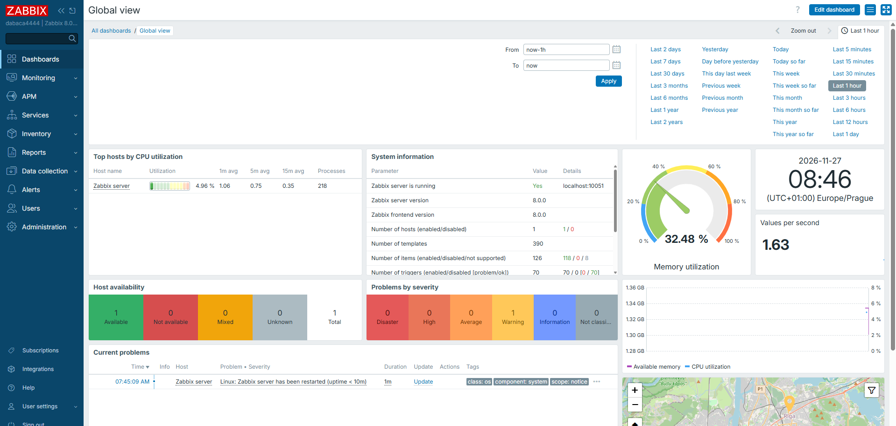
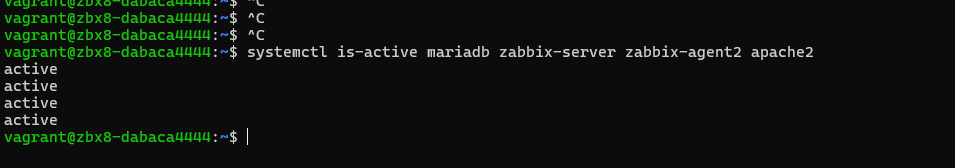
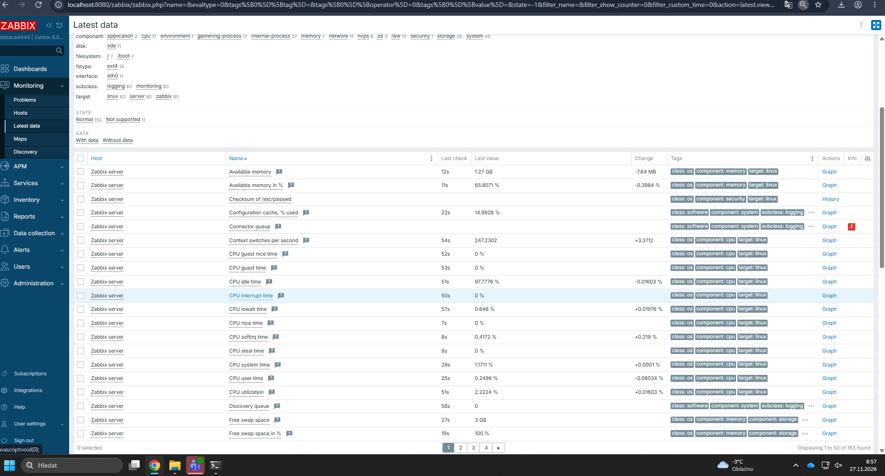
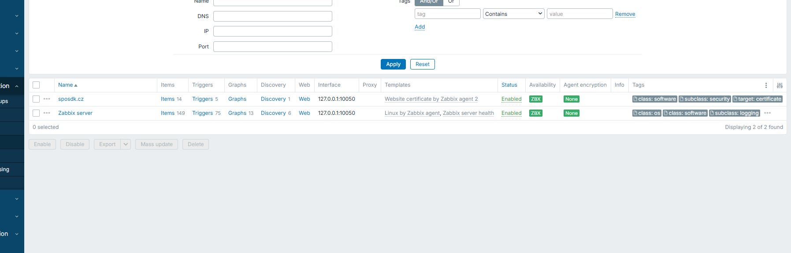

# Samostatná práce: Instalace Zabbixu 8.0 LTS

Tento projekt automaticky vytvoří virtuální stroj s **Debianem 13** a nainstaluje do něj **Zabbix server 8.0 LTS** s databází **MariaDB**, webovým rozhraním (Apache) a **Zabbix Agentem 2**. Všechno se spustí jedním příkazem `vagrant up`, bez ruční instalace čehokoli uvnitř virtuálního stroje.

## Co jsem udělal

Vytvořil jsem `Vagrantfile` a dva shell skripty, které se spouští jako Vagrant provisioning:

- **`Vagrantfile`**: box `bento/debian-13` pro VirtualBox, 2 CPU a 2 GB RAM, hostname `zbx8-dabaca4444`. HTTP port 80 z virtuálního stroje je přesměrovaný na port **8080** na `127.0.0.1` hostitele, SSH také jen na `127.0.0.1` (port 2222).
- **`scripts/install-zabbix.sh`**: hlavní instalační skript. Při jakékoli chybě skončí nenulovým návratovým kódem (`set -Eeuo pipefail`). Postupně:
  1. přidá oficiální repozitář **Zabbix 8.0 pro Debian 13** (balíček `zabbix-release`),
  2. nainstaluje MariaDB, `zabbix-server-mysql`, `zabbix-frontend-php`, `zabbix-apache-conf`, `zabbix-sql-scripts` a `zabbix-agent2`,
  3. vytvoří databázi `zabbix` s kódováním `utf8mb4` a uživatele `zabbix`, který má práva jen k této databázi,
  4. naimportuje počáteční schéma právě jednou (kontroluje se existence tabulky `dbversion`), takže opakované `vagrant provision` databázi nezničí,
  5. nastaví heslo databáze v `zabbix_server.conf` a heslo uživatele `Admin` ve webovém rozhraní,
  6. nakonfiguruje Agenta 2 pro monitorování lokálního serveru (`Server=127.0.0.1`, `Hostname=Zabbix server`),
  7. vygeneruje `/etc/zabbix/web/zabbix.conf.php`, takže se nemusí procházet PHP wizard, a nastaví vlastní název serveru v záhlaví webu,
  8. nastaví časovou zónu Apache a přesměrování `/` na `/zabbix/`,
  9. spustí a povolí služby MariaDB, Zabbix server, Zabbix Agent 2 a Apache a ověří, že běží a že web odpovídá.
- **`scripts/import-host.sh`**: volitelný skript, který přes Zabbix API naimportuje host `sposdk.cz` ze souboru v `Zabbix/export`. Spouští se ručně (viz níže).

## Předpoklady

- VirtualBox
- Vagrant
- Git
- připojení k internetu (stahování boxu, balíčků a kontrola certifikátu `sposdk.cz`)

## Hesla

Žádné heslo není uložené v repozitáři, ve skriptech ani v tomto README. Předávají se při spuštění jako **proměnné prostředí** v aktuálním okně terminálu:

- `ZBX_DB_PASSWORD` je heslo uživatele `zabbix` v databázi (jen písmena a číslice),
- `ZBX_ADMIN_PASSWORD` je heslo uživatele `Admin` ve webovém rozhraní.

`Vagrantfile` je přečte z prostředí hostitele a předá skriptu. Pokud `ZBX_DB_PASSWORD` chybí, skript skončí s chybou a nic neinstaluje. Heslo k databázi se pak používá v `/etc/zabbix/zabbix_server.conf` (práva 640, `root:zabbix`) a `/etc/zabbix/web/zabbix.conf.php` (práva 640, `root:www-data`) uvnitř virtuálního stroje. Při dalším `vagrant provision` bez proměnné si skript heslo přečte z `zabbix_server.conf`.

## Spuštění

Příkazy v PowerShellu ve složce projektu:

```powershell
git clone https://github.com/sposdknl/dabaca4444-alt-osy-2026-zbx8-inst.git
cd dabaca4444-alt-osy-2026-zbx8-inst


$env:ZBX_DB_PASSWORD="<heslo-db>"
$env:ZBX_ADMIN_PASSWORD="<heslo-admin>"

vagrant up
```

Proměnné platí jen v okně, kde jsem je nastavil. Po otevření nového okna je musím zadat znovu.

Další příkazy:

```powershell
vagrant ssh          # přihlášení do virtuálního stroje
vagrant provision    # znovu spustí instalační skript (databázi nemaže)
vagrant destroy -f   # smaže virtuální stroj
```

Instalace trvá několik minut a končí hláškou `HOTOVO`.

## Webové rozhraní

Adresa z hostitelského počítače: **http://127.0.0.1:8080/zabbix**

Přihlášení: uživatel `Admin` a heslo z proměnné `ZBX_ADMIN_PASSWORD`. V záhlaví webu je můj vlastní název serveru `dabaca4444 | Zabbix 8.0 LTS`.



## Ověření monitorování

### Běh služeb

```powershell
vagrant ssh -c "systemctl is-active mariadb zabbix-server zabbix-agent2 apache2"
```

Všechny čtyři služby vrací `active`.



### Lokální host a Agent 2

Ve webu jsem v **Data collection → Hosts** otevřel výchozí host `Zabbix server`, který odpovídá lokálnímu Debianu 13 (Agent 2 má `Hostname=Zabbix server`), a ověřil přiřazenou šablonu pro Zabbix agenta. V **Monitoring → Latest data** jsou vidět aktuální hodnoty z agenta.



### Monitoring certifikátu `sposdk.cz`

Host `sposdk.cz` se šablonou **Website certificate by Zabbix agent 2** jsem naimportoval ze souboru v `Zabbix/export`:

```powershell
vagrant provision --provision-with import-host
```

Skript se přihlásí do API jako `Admin` (heslo z `ZBX_ADMIN_PASSWORD`) a zavolá `configuration.import`. Import lze udělat i ručně přes **Data collection → Hosts → Import**.

Export je ve formátu Zabbixu 7.0. import do 8.0 proběhl bez úprav .

Host se ptá lokálního Agenta 2 na `127.0.0.1:10050`, takže virtuální stroj musí mít přístup na internet. Hodnoty certifikátu (platnost, vydavatel a další) se objeví v **Monitoring → Latest data** zhruba za minutu až dvě po importu.



## Řešení potíží, na které jsem narazil

- **Vagrant hlásil `Box 'base' could not be found`.** Spouštěl jsem `vagrant up` ve špatné složce, kde byl jen výchozí `Vagrantfile` z `vagrant init` s boxem `base`. Pomohlo přejít do složky repozitáře, kde je můj `Vagrantfile` s boxem `bento/debian-13`.
- **Skript skončil s hláškou `chybi ZBX_DB_PASSWORD`.** V okně PowerShellu nebyly nastavené proměnné s hesly. Po jejich nastavení stačilo spustit `vagrant provision`, virtuální stroj nebylo nutné mazat.
- **Konce řádků na Windows.** Skripty musí mít konce řádků LF, jinak bash ve virtuálním stroji selže s chybou `\r: command not found`. Proto je v repozitáři `.gitattributes` s pravidlem `*.sh text eol=lf`.

## Struktura repozitáře

```
Vagrantfile
.gitignore
.gitattributes
scripts/install-zabbix.sh
scripts/import-host.sh
Zabbix/export/        # exporty hosta sposdk.cz
Images/               # snímky obrazovky
README.md
```
